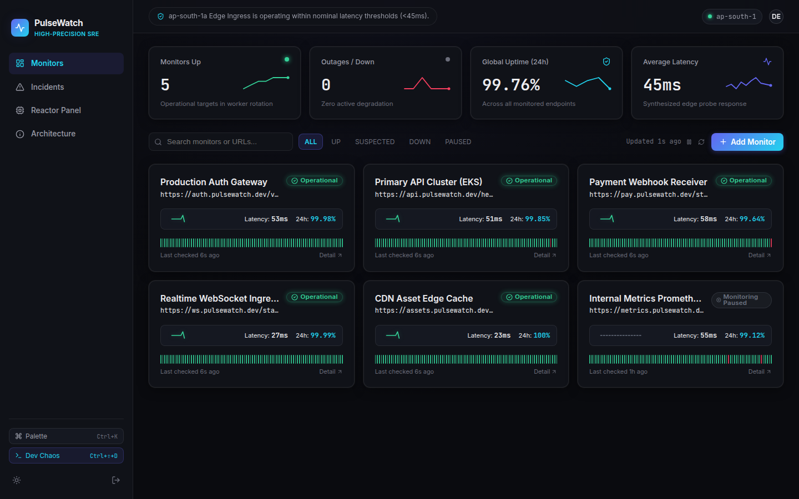
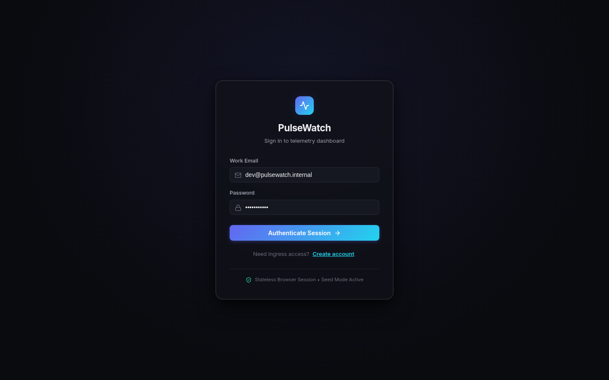
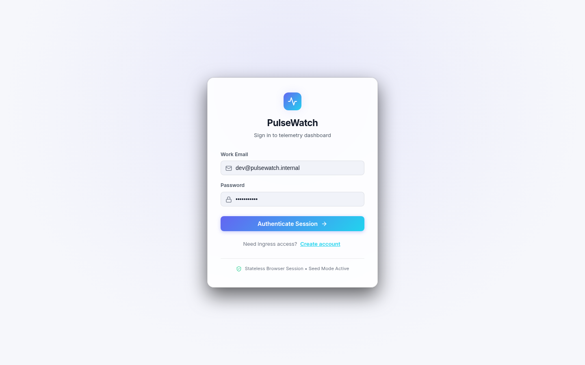
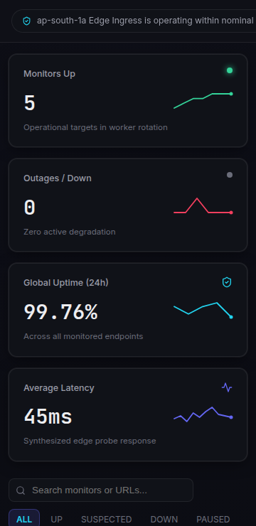
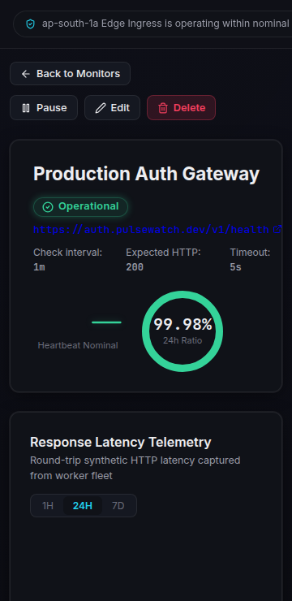

# PulseWatch — High-Precision Uptime & Synthetic Latency Monitor

PulseWatch is an enterprise-grade website and API uptime monitoring platform styled with a calm, high-precision dark aesthetic inspired by Linear and Vercel.

Designed for production deployment to **Amazon Web Services (AWS ap-south-1)** using **S3 + CloudFront**, PulseWatch features a completely decoupled architecture that runs against a realistic browser-side Mock API with persistence and chaos injection, switchable to a real AWS backend by altering a single configuration constant.

---

## Key Features

- **Signature ECG Heartbeat**: SVG animated waveform reflecting real-time state:
  - `UP`: Steady emerald pulse
  - `SUSPECTED`: Pulsing amber arrhythmia (`"Re-checking to confirm..."`)
  - `DOWN`: Crisp red flatline
  - `PAUSED`: Slate dotted line
- **Zero-Dependency SVG Visualizations**:
  - Pure SVG latency area chart with crosshair hover tooltips
  - 90-segment daily reliability strip with tooltips
  - Radial uptime percentage progress ring
  - Micro-sparklines inside stat cards
- **Robust SRE State Machine**:
  - `PENDING -> UP -> SUSPECTED -> DOWN -> UP`.
  - A single failed check *never* triggers DOWN, preventing false alarm fatigue.
- **SSRF Attack Protection**: Built-in validation blocks RFC 1918 private CIDR blocks and AWS metadata endpoints (`169.254.x`) unless whitelisted.
- **Interactive System Reactor Panel**: Monitors serving EC2 API instances, SQS ingress queue depth, dead-letter queues, and dynamic worker nodes that glow and scale out (1 to 3 workers) under load.
- **Developer Chaos Control Panel (`Ctrl+Shift+D`)**: Trigger outages, simulate packet loss, test SQS worker scaling (1 -> 3), and switch ALB availability zones.
- **Keyboard-Driven Command Palette (`Ctrl+K`)**: Rapidly search monitors, jump across views, and toggle dark/light theme.

---

## Getting Started

### 1. Prerequisites
- Node.js (v18.0.0 or higher recommended)
- npm or pnpm

### 2. Installation
```bash
npm install
```

### 3. Running the Development Server
```bash
npm run dev
```
The application will launch at `http://localhost:5173/`.

### 4. Compiling for Production
```bash
npm run build
```
Generates a static production bundle in `dist/`, fully optimized and self-contained with relative asset linking (`base: "./"`) for direct deployment to Amazon S3 without rewrite rules. Total distribution size excluding fonts is under 330 KB.

---

## Switching Between Mock API and Real AWS Backend

PulseWatch is built with a single-source configuration architecture. **Only one file needs to be modified:**

Open `src/config.js`:
```javascript
export const CONFIG = {
  // Change from 'mock' to 'real'
  API_MODE: 'real',

  // Defaults to '' (relative path) because CloudFront routes /api/* to the backend ALB
  API_BASE_URL: '',

  // Allowed private hosts bypass (optional)
  ALLOWED_PRIVATE_HOSTS: ['127.0.0.1:8080'],
  
  // Worker Auto Scaling Group bounds
  WORKER_MIN: 1,
  WORKER_MAX: 3,

  // Real backend timeout (ms)
  REQUEST_TIMEOUT_MS: 10000,
};
```

When `API_MODE` is `'mock'`:
- All requests are resolved in-browser with realistic 80–300ms network jitter.
- State is preserved in `localStorage`.
- Background simulation continuously updates checks and resolves active incidents.

When `API_MODE` is `'real'`:
- Requests are dispatched via standard `fetch()` with `Authorization: Bearer <token>`.
- Any 401 Unauthorized response clears the session and sends the user to `#/login`.
- Network errors or timeouts (>10s) trigger a friendly banner and error toast while keeping last-known data visible.

### Testing Real Mode with the Included Stub Server

A minimal, zero-dependency Node.js stub server is provided in `stub-server.js`:

```bash
# In one terminal, start the stub backend:
node stub-server.js

# In src/config.js, temporarily point to the stub:
# API_MODE: 'real'
# API_BASE_URL: 'http://localhost:4000'

# In another terminal, launch the dev server:
npm run dev
```
This lets you verify real HTTP requests, CORS headers, and bearer authentication before AWS infrastructure is deployed.

---

## Keyboard Shortcuts

| Shortcut | Description |
| :--- | :--- |
| `Ctrl + K` / `Cmd + K` | Opens the Command Palette to search monitors and jump to routes |
| `Ctrl + Shift + D` | Opens the Chaos Engineering & Dev Control Panel |
| `ESC` | Closes any open modal, dialog, or drawer |

---

## Application Screenshots

Captured directly from the running web application:

### 1. Telemetry Dashboard (1440px Desktop)

*Displays 4 sparkline stat cards, auto-refresh ticker, filter bar, and monitor cards with live ECG heartbeats and 30-day strips.*

### 2. Deep Monitor Inspection & SVG Latency Chart

*Detailed response time area chart with crosshair hover tooltips, 90-day strip, and synthetic probe table.*

### 3. Outage & Multi-Probe Confirmation Sequence

*Demonstrates the critical state transition: `UP` -> `SUSPECTED` (pulsing amber) -> `DOWN` (flatline) -> `UP` (recovery).*

### 4. System Incidents Ledger

*Audit record of probe failures, state transitions, durations, and CSV report export link.*

### 5. System Reactor Panel & Auto-Scaling Worker Fleet

*Displays EC2 instance AZ, SQS queue depths, and worker fleet scaling dynamically from 1 to 3 glowing nodes during a load spike.*

### 6. AWS Architecture & Subsystems (About Page)

*Interactive SVG topology mapping CloudFront, ALB, EC2 ASGs, SQS, DynamoDB Streams, and Step Functions.*

### 7. Command Palette (`Ctrl+K`)

*Fuzzy search across all registered monitors and instant keyboard navigation.*

### 8. Light Theme Option

*High-contrast clean daylight palette toggled via user preference and persisted in `localStorage`.*

### 9. Mobile Viewport (360px Dashboard & Detail)


*Desktop sidebar transforms into an ergonomic bottom tab bar with touch-optimized controls.*
