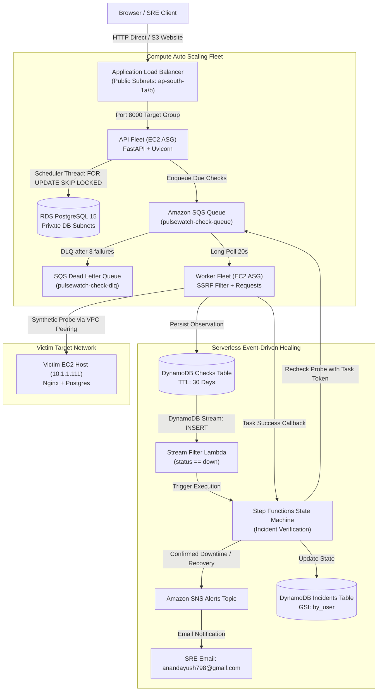

# PulseWatch: Cloud-Native Synthetic Uptime & Resilience Monitoring Platform
## Master Technical Viva & Systems Architecture Documentation

---

## Table of Contents
1. [Project Overview](#1-project-overview)
2. [What Was Built, In Order (Build Timeline & Evolution)](#2-what-was-built-in-order-build-timeline--evolution)
3. [Whole Architecture & System Topology](#3-whole-architecture--system-topology)
   - [3.1 Main Component Architecture Diagram](#31-main-component-architecture-diagram)
   - [3.2 Network Architecture & Security Boundaries](#32-network-architecture--security-boundaries)
   - [3.3 Request Flow (Browser to Data Layer)](#33-request-flow-browser-to-data-layer)
   - [3.4 Check Flow (Scheduler to Probe Ingestion)](#34-check-flow-scheduler-to-probe-ingestion)
   - [3.5 Alert & Recovery Flow (Stream to Step Functions to SNS)](#35-alert--recovery-flow-stream-to-step-functions-to-sns)
   - [3.6 Security & Identity Architecture](#36-security--identity-architecture)
4. [How Everything Works (Step-by-Step Technical Walkthrough)](#4-how-everything-works-step-by-step-technical-walkthrough)
   - [4.1 User Authentication Flow](#41-user-authentication-flow)
   - [4.2 Monitor Creation & SSRF Validation](#42-monitor-creation--ssrf-validation)
   - [4.3 Distributed Scheduler & Atomic Row Locking](#43-distributed-scheduler--atomic-row-locking)
   - [4.4 Worker Probe Execution & SQS Ingestion](#44-worker-probe-execution--sqs-ingestion)
   - [4.5 Outage Detection, Step Functions & Task Tokens](#45-outage-detection-step-functions--task-tokens)
   - [4.6 Automated Recovery Polling Loop](#46-automated-recovery-polling-loop)
   - [4.7 Dashboard Telemetry & Uptime Math](#47-dashboard-telemetry--uptime-math)
   - [4.8 Presigned S3 CSV Report Generation](#48-presigned-s3-csv-report-generation)
   - [4.9 System Health & IMDSv2 Inspection](#49-system-health--imdsv2-inspection)
   - [4.10 Auto Scaling & Step Scaling Policies](#410-auto-scaling--step-scaling-policies)
   - [4.11 Failure Modes & Fault Tolerance](#411-failure-modes--fault-tolerance)
   - [4.12 Exact Database Schemas & Message Payloads](#412-exact-database-schemas--message-payloads)
5. [AWS Services Used, Mapped to Academic Syllabus (M1–M8)](#5-aws-services-used-mapped-to-academic-syllabus-m1m8)
6. [Infrastructure as Code & Operational Scripts](#6-infrastructure-as-code--operational-scripts)
7. [Security, Financial Governance & Well-Architected Assessment](#7-security-financial-governance--well-architected-assessment)
8. [Operations & Viva Demonstration Guide](#8-operations--viva-demonstration-guide)
9. [Corrections, Realities & Discrepancy Disclosures](#9-corrections-realities--discrepancy-disclosures)
10. [Glossary of AWS & Systems Architecture Terms](#10-glossary-of-aws--systems-architecture-terms)

---

## 1. Project Overview

### 1.1 What PulseWatch Is
**PulseWatch** is a production-grade synthetic uptime monitoring and distributed resilience verification platform hosted natively on Amazon Web Services (AWS) in the Mumbai region (`ap-south-1`). It continuously assesses the health, HTTP response codes, and round-trip network latency of internal cloud microservices and external web endpoints.

### 1.2 The Problem It Solves
1. **Network Blindness & SSRF Exposure**: Traditional cloud monitoring fleets either require internal hosts to expose public ingress ports or open monitoring workers to severe Server-Side Request Forgery (SSRF) vulnerabilities when attackers force workers to query internal metadata services (`169.254.169.254`) or private RFC1918 subnets.
2. **Alert Fatigue**: Transient network blips or momentary packet loss frequently trigger false-positive pager alerts, desensitizing site reliability engineers.
3. **Runaway Cloud Costs**: High-frequency monitoring agents that write timeseries metrics into relational databases inevitably bloat database storage and exhaust connection pools.

### 1.3 Who Uses It
Site Reliability Engineers (SREs), DevOps practitioners, and cloud infrastructure engineers who require independent, multi-AZ verification of both private VPC infrastructure and public customer-facing domains without vendor lock-in.

### 1.4 The 10-Line Viva Demonstration Story
1. The operator opens the PulseWatch React dashboard and logs in using authenticated JWT credentials.
2. The user registers an internal service (`http://10.1.1.111/healthz`) located across an isolated VPC Peering connection.
3. The distributed API scheduler atomically reserves the due monitor using PostgreSQL `SELECT ... FOR UPDATE SKIP LOCKED`.
4. A message is enqueued into an encrypted Amazon SQS queue without risk of duplicate execution.
5. An autonomous worker daemon consumes the task, validates target safety against strict SSRF rules, probes the endpoint, and persists latency to Amazon DynamoDB.
6. The operator simulates an infrastructure failure by stopping Nginx on the target host via AWS Systems Manager.
7. The failed check is captured in DynamoDB Streams, which triggers an AWS Lambda filter.
8. AWS Step Functions initiates a serverless state machine, coordinating 2 distinct recheck probes across 50 seconds using SQS Task Tokens to eliminate transient false alarms.
9. Upon confirmed downtime, an urgent alert email is dispatched via Amazon SNS, and the dashboard flatlines to `DOWN`.
10. The operator restores Nginx; Step Functions detects recovery in its polling loop, updates DynamoDB, restores the dashboard heartbeat to green, and dispatches a recovery email.

### 1.5 Technology Stack
- **Frontend**: React 18, Vite, Lucide-React, React Router DOM, deployed to Amazon S3 static website hosting with CloudFront Origin Access Control architecture.
- **Backend API**: Python 3.9+, FastAPI, Uvicorn, psycopg2-binary, bcrypt, PyJWT, boto3, deployed as a systemd service on EC2 Auto Scaling Groups.
- **Worker Daemon**: Python autonomous daemon long-polling Amazon SQS with kernel-level socket IP resolution and SSRF filtering.
- **Relational Storage**: Amazon RDS PostgreSQL 15 (`db.t4g.micro`, Single-AZ, 20 GB gp3 encrypted with KMS).
- **NoSQL Timeseries**: Amazon DynamoDB on-demand tables with DynamoDB Streams and 30-day automated TTL.
- **Orchestration & Serverless**: AWS Lambda (Python runtime) and AWS Step Functions distributed state machine.
- **Infrastructure as Code (IaC)**: 100% modular HashiCorp Terraform (~5.0 AWS provider) using S3 remote state and DynamoDB state locking.

---

## 2. What Was Built, In Order (Build Timeline & Evolution)

```
[ Mock Prototype ] ──► [ Stage 1: Foundation ] ──► [ Stage 2: Data & Messaging ]
                                                             │
[ Stage 5: Workflow & Governance ] ◄── [ Stages 3 & 4: Compute, API & Edge ]
             │
             ▼
[ Stage 6: Extras & Final Polish ] ──► [ Operational Cost Pause ]
```

### Step 1: Mock Frontend Prototype
- **What was done**: Developed the React SPA featuring an interactive dashboard, monitor modals, incident logs, system telemetry, and a mock backend simulation engine in `src/mock/engine.js`.
- **Why**: Established the exact visual language, data contracts, and UX prior to cloud infrastructure provisioning.

### Step 2: Stage 1 — Foundation & Core Networking
- **What was done**: Initialized remote S3 state (`pulsewatch-tfstate-826903518995`), customer-managed KMS key (`alias/pulsewatch-kms`), Main VPC (`10.0.0.0/16`) spanning 2 AZs, isolated Victim VPC (`10.1.0.0/16`), VPC Peering (`pcx-0f2306f05a2b2ac72`), S3 Gateway VPC Endpoint, and the Victim EC2 instance (`10.1.1.111`).
- **Problems & Solutions**:
  - *Problem*: Victim host internal DNS could not resolve across VPC peering without private Route 53 zones ($0.50/mo).
  - *Solution*: Whitelisted direct private IP `10.1.1.111` in SSM parameter `/pulsewatch/allowed_private_hosts`.

### Step 3: Stage 2 — Polyglot Data & Asynchronous Messaging Tier
- **What was done**: Provisioned RDS PostgreSQL 15 (`db.t4g.micro`) in isolated private subnets, DynamoDB table `pulsewatch-checks` (with Streams & TTL) and `pulsewatch-incidents` (with GSI `by_user`), Amazon SQS queue `pulsewatch-check-queue` (with DLQ), and Amazon SNS alert topic.
- **Problems & Solutions**:
  - *Problem*: Passing database master passwords in plaintext or committed tfvars violates security compliance.
  - *Solution*: Generated cryptographically random 28-character password locally via Terraform `random_password`, written directly to encrypted SSM SecureString `/pulsewatch/db_password`.

### Step 4: Stages 3 & 4 — Compute Fleet, FastAPI Backend, Edge & Automation
- **What was done**: Implemented `backend/app.py` and `backend/worker.py`. Provisioned Application Load Balancer (ALB), Target Group with `/api/health`, Launch Templates (AL2023, IMDSv2, KMS-encrypted EBS), API ASG (1–2 `t3.micro`), and Worker ASG (1–3 `t3.micro`) with SQS queue-depth step scaling.
- **Problems & Solutions**:
  - *Problem 1 (Amazon Linux 2023 RPM conflict)*: Pinned `urllib3 2.2.1` conflicted with system botocore packages.
  - *Fix*: Created dedicated Python virtual environment `/opt/pulsewatch/venv` in user data and removed strict pins.
  - *Problem 2 (CloudFront Account Verification)*: CloudFront global distributions in newly opened AWS accounts are subject to automatic security verification by AWS Trust & Safety, resulting in a temporary distribution freeze.
  - *Fix*: Enabled S3 static website hosting on `pulsewatch-frontend-826903518995` and added a secure fallback ingress rule on the ALB restricted by the operator's public IP (`my_ip_cidr`) and origin header validation.
  - *Problem 3 (Presigned S3 URL Signature Mismatch)*: Download links for incident CSV exports returned HTTP 403 due to SigV4 regional endpoint canonicalization differences.
  - *Fix*: Explicitly configured `boto3.client('s3')` with regional endpoint `s3.ap-south-1.amazonaws.com` and `signature_version="s3v4"`.

### Step 5: Stage 5 — Serverless Incident Workflow & Cloud Governance
- **What was done**: Built DynamoDB Stream event source mapping, Lambda filter (`pulsewatch-stream-filter`), and Step Functions state machine (`pulsewatch-incident-workflow`). Configured CloudWatch Dashboard (`pulsewatch-overview`), metric alarms (`treat_missing_data = "notBreaching"`), CloudTrail audit logging, and AWS Config compliance recorder.
- **Problems & Solutions**:
  - *Problem 1 (KMS Stream Shard Decrypt)*: Lambda failed to read encrypted DynamoDB stream shards with `AccessDeniedException`.
  - *Fix*: Added explicit `kms:Decrypt` permission on `alias/pulsewatch-kms` to `pulsewatch-stream-lambda-role`.
  - *Problem 2 (DynamoDB GSI String Type Mismatch)*: Step Functions wrote numeric Unix timestamps to `startedAt`, violating GSI `by_user` String key constraint.
  - *Fix*: Updated Step Functions task state to format timestamps as strings: `{"S.$": "States.Format('{}', $.startedAt)"}`.

### Step 6: Stage 6 — Demo Extras, Live Outage Proof & Cost Governance
- **What was done**: Implemented `scripts/demo-outage.sh`, `scripts/demo-extras.sh`, and `scripts/teardown.sh`. Sequentially tested AWS WAFv2 Web ACL (blocking directory traversal attack with HTTP 403), RDS Multi-AZ reboot failover, and RDS Read Replica replication.
- **Final Action**: Executed `./scripts/pause.sh light`, scaling compute fleets to 0, stopping RDS and Victim instances, and halting active billing to conserve student credits.

---

## 3. Whole Architecture

### 3.1 Main Component Architecture Diagram



#### ASCII Architecture Diagram (Fallback)
```
+---------------------------------------------------------------------------------------------------+
|                                     BROWSER / SRE OPERATOR                                        |
+---------------------------------------------------------------------------------------------------+
                                                  |
                                                  v
+---------------------------------------------------------------------------------------------------+
|                              APPLICATION LOAD BALANCER (ALB)                                      |
|                 (Public Subnets 10.0.1.0/24 & 10.0.2.0/24, Port 80 Ingress)                       |
+---------------------------------------------------------------------------------------------------+
                                                  | Port 8000
                                                  v
+---------------------------------------------------------------------------------------------------+
|                               API AUTO SCALING GROUP (1-2 x t3.micro)                             |
|                           (FastAPI, Distributed Atomic Scheduler Loop)                            |
+---------------------------------------------------------------------------------------------------+
         |                                                                      |
         | SELECT ... FOR UPDATE SKIP LOCKED                                    | SQS Enqueue
         v                                                                      v
+-------------------------------------+             +-----------------------------------------------+
|      RDS POSTGRESQL 15 (DB)         |             |       AMAZON SQS (pulsewatch-check-queue)      |
| (Private Subnets: 10.0.11.0/24)     |             |       (KMS Encrypted, Dead-Letter Queue)      |
+-------------------------------------+             +-----------------------------------------------+
                                                                            |
                                                                            | Long Poll 20s
                                                                            v
+---------------------------------------------------------------------------------------------------+
|                             WORKER AUTO SCALING GROUP (1-3 x t3.micro)                            |
|                       (Autonomous Daemon, SSRF Validation, Metric Ingestion)                      |
+---------------------------------------------------------------------------------------------------+
         |                                                                      |
         | Probe over VPC Peering (pcx-0f2306f05a2b2ac72)                       | Write Observation
         v                                                                      v
+-------------------------------------+             +-----------------------------------------------+
|     VICTIM EC2 HOST (10.1.1.111)    |             |      DYNAMODB TABLE (pulsewatch-checks)       |
|    (Isolated Victim VPC: 10.1.0.0)  |             |      (Streams Enabled, Automated 30-Day TTL)  |
+-------------------------------------+             +-----------------------------------------------+
                                                                            |
                                                                            | DynamoDB Stream Shard
                                                                            v
                                                    +-----------------------------------------------+
                                                    |     AWS LAMBDA (pulsewatch-stream-filter)     |
                                                    +-----------------------------------------------+
                                                                            |
                                                                            | StartExecution
                                                                            v
                                                    +-----------------------------------------------+
                                                    |      AWS STEP FUNCTIONS STATE MACHINE         |
                                                    |       (Outage Re-verification Loop)           |
                                                    +-----------------------------------------------+
                                                       |                          |
                                      Task Token Probe |                          | Alert Notification
                                                       v                          v
                                              [ Amazon SQS Queue ]       [ Amazon SNS Alerts Topic ]
                                                                                  |
                                                                                  v
                                                                        [ SRE Alert Email ]
```

### 3.2 Network Architecture & Security Boundaries

```
[ AWS Region: ap-south-1 (Mumbai) ]
=====================================================================================================
MAIN VPC: 10.0.0.0/16
-----------------------------------------------------------------------------------------------------
  Availability Zone: ap-south-1a                     Availability Zone: ap-south-1b
  +---------------------------------------------+    +---------------------------------------------+
  | PUBLIC SUBNET 1 (10.0.1.0/24)               |    | PUBLIC SUBNET 2 (10.0.2.0/24)               |
  |  • Application Load Balancer Node A         |    |  • Application Load Balancer Node B         |
  |  • API ASG Instance (Public IP)             |    |  • Worker ASG Instance (Public IP)          |
  |  • Route: 0.0.0.0/0 -> Internet Gateway     |    |  • Route: 0.0.0.0/0 -> Internet Gateway     |
  |  • Route: 10.1.0.0/16 -> VPC Peering (PCX)  |    |  • Route: 10.1.0.0/16 -> VPC Peering (PCX)  |
  +---------------------------------------------+    +---------------------------------------------+
  | PRIVATE DB SUBNET 1 (10.0.11.0/24)          |    | PRIVATE DB SUBNET 2 (10.0.12.0/24)          |
  |  • RDS PostgreSQL Primary (db.t4g.micro)    |    |  • RDS Subnet Group Standby Allocation      |
  |  • Route: Local 10.0.0.0/16 ONLY            |    |  • Route: Local 10.0.0.0/16 ONLY            |
  |  • ZERO Internet Ingress / Zero Egress      |    |  • ZERO Internet Ingress / Zero Egress      |
  +---------------------------------------------+    +---------------------------------------------+
  Gateway VPC Endpoint: com.amazonaws.ap-south-1.s3 (Direct, Free S3 routing for Artifacts & Logs)
=====================================================================================================
                                 ▲
                                 │ VPC Peering Connection (pcx-0f2306f05a2b2ac72)
                                 ▼
=====================================================================================================
VICTIM VPC: 10.1.0.0/16 (Isolated Target Environment)
-----------------------------------------------------------------------------------------------------
  Availability Zone: ap-south-1a
  +-------------------------------------------------------------------------------------------------+
  | VICTIM SUBNET (10.1.1.0/24)                                                                     |
  |  • Victim EC2 Instance: 10.1.1.111 (Nginx HTTP :80, PostgreSQL :5432)                           |
  |  • Route: 0.0.0.0/0 -> Internet Gateway (for package install during provisioning)               |
  |  • Route: 10.0.0.0/16 -> VPC Peering Connection (pcx-0f2306f05a2b2ac72)                        |
  +-------------------------------------------------------------------------------------------------+
```

### 3.3 Security Groups & Least-Privilege Rules

| Security Group | Inbound Rules | Outbound Rules | Design Rationale |
| :--- | :--- | :--- | :--- |
| **ALB SG** (`sg-0d8d5377e673cccb4`) | Port 80 from CloudFront Prefix List (`pl-9aa247f3`) & `my_ip_cidr` | All traffic (`0.0.0.0/0`) | Only allows edge requests; restricts direct testing to operator IP. |
| **API SG** (`sg-0cc651b04d675d2f4`) | Port 8000 strictly from **ALB SG** | All traffic (`0.0.0.0/0`) | API instances are completely unreachable from the public internet. |
| **Worker SG** (`sg-0cab50ade5e251889`) | **ZERO INBOUND PORTS OPEN** | All traffic (`0.0.0.0/0`) | Workers only pull from SQS and push outbound HTTP probes. Complete immunity from network ingress attacks. |
| **RDS DB SG** (`sg-002fb48c3b7b7202f`) | Port 5432 strictly from **API SG** | All traffic (`0.0.0.0/0`) | Workers, victims, and internet entities cannot open connections to PostgreSQL. |
| **Victim SG** (`sg-0158fa996962cb1fc`) | Port 80 & 5432 strictly from **Worker SG** | All traffic (`0.0.0.0/0`) | Target only responds to synthetic probes initiated by authorized workers. |

---

## 4. How Everything Works (Step-by-Step Technical Walkthrough)

### 4.1 User Authentication Flow
1. User submits `POST /api/auth/register` with email and password.
2. The API generates a random UUID, salts and hashes the password using `bcrypt` (12 rounds), and persists the record into PostgreSQL `users` table.
3. Upon `POST /api/auth/login`, the API fetches `password_hash`, validates with `bcrypt.checkpw()`, and signs a JSON Web Token (JWT) using `HS256` signed by the 48-character KMS-backed secret `/pulsewatch/jwt_secret`.
4. Subsequent client requests send header `Authorization: Bearer <token>`. Dependency `get_current_user` decodes the token, enforces expiration, and extracts the user UUID.

### 4.2 Monitor Creation & SSRF Validation
1. User submits `POST /api/monitors` with URL, check interval (1–60 min), timeout (1–30s), and expected HTTP status.
2. The URL passes through kernel-level DNS resolution via `socket.gethostbyname_ex()`.
3. If any resolved IP falls into `127.0.0.0/8` (loopback), `10.0.0.0/8`, `172.16.0.0/12`, `192.168.0.0/16` (RFC1918), or `169.254.169.254` (cloud metadata), the request is rejected with **HTTP 400 SSRF Policy Violation** unless explicitly matching `/pulsewatch/allowed_private_hosts` (`10.1.1.111`).
4. Valid monitors are saved into PostgreSQL `monitors` table with `next_check_at = NOW()`.

### 4.3 Distributed Scheduler & Atomic Row Locking
1. A background daemon thread inside `backend/app.py` runs every 15 seconds.
2. To guarantee zero duplicate check dispatches when multiple API instances run in the ASG, the query uses PostgreSQL's row-level locking feature:
   ```sql
   UPDATE monitors
   SET next_check_at = NOW() + (interval_min * INTERVAL '1 minute')
   WHERE id IN (
       SELECT id FROM monitors
       WHERE paused = FALSE AND next_check_at <= NOW()
       ORDER BY next_check_at
       LIMIT 50
       FOR UPDATE SKIP LOCKED
   )
   RETURNING id, name, url, expected_status, timeout_sec;
   ```
3. `FOR UPDATE SKIP LOCKED` atomically reserves due rows. If Instance A is processing rows 1–10, Instance B skips those rows instantly and reserves rows 11–20 without waiting or blocking.
4. For each claimed monitor, the thread enqueues an SQS message into `pulsewatch-check-queue`.
5. The thread scans DynamoDB for active downtime items and publishes the custom CloudWatch metric `SitesDown` to namespace `PulseWatch/Metrics`.

### 4.4 Worker Probe Execution & SQS Ingestion
1. The autonomous `worker.py` daemon long-polls `pulsewatch-check-queue` using `WaitTimeSeconds=20` (reducing empty API calls to near zero).
2. For each message, it re-verifies the URL against the SSRF validator.
3. It dispatches a non-streaming HTTP GET request with a strict socket timeout.
4. It measures high-resolution execution latency via `time.perf_counter()`.
5. For standard checks (`type == "check"`), it executes an idempotent conditional write to DynamoDB table `pulsewatch-checks`:
   - Partition Key: `monitor_id` (String)
   - Sort Key: `ts` (Unix epoch timestamp in milliseconds)
   - Attributes: `latency_ms`, `http_code`, `status` (`up`/`down`), `ttl` (current timestamp + 30 days).
6. If the probe fails, `status` is set to `"down"`.
7. The worker deletes the message from SQS via its receipt handle. If the worker crashes before deleting, SQS's 60-second visibility timeout restores the message to the queue. After 3 failed attempts, SQS routes the message to `pulsewatch-check-dlq`.

### 4.5 Outage Detection, Step Functions & Task Tokens (Simplified Alert Workflow)
1. When a failed synthetic check (`status = "down"`, `source = "scheduled"`) is committed to DynamoDB, DynamoDB Streams emits a `NEW_IMAGE` event record.
2. The event invokes `pulsewatch-stream-filter` Lambda via an Event Source Mapping.
3. Lambda extracts `monitorId`, `userId`, `monitorName`, `url`, `error`, and `startedAt` from the stream record and generates a deterministic execution name: `inc-<monitor_id[:16]>-<ts>`. If an execution with this name already exists, AWS Step Functions rejects the call, preventing duplicate concurrent workflows for the same incident.
4. **Step Functions Workflow Execution**:
   - `MarkSuspected`: DynamoDB conditional update sets state to `SUSPECTED` in `pulsewatch-incidents`. If the monitor is already marked `DOWN` or `SUSPECTED`, it terminates cleanly (`AlreadyHandlingOutage`).
   - `WaitBeforeRecheck`: State machine pauses for **5 seconds** (`recheck_wait_seconds = 5`) at **$0 compute cost**.
   - `ExecuteRecheck`: Dispatches a single re-verification check message to SQS containing an AWS Step Functions Task Token using `.waitForTaskToken` (Timeout: 45s).
   - A worker fleet member picks up the recheck job, probes the URL, and invokes `sfn_client.send_task_success(taskToken, output)` or reports failure.
   - `EvaluateRecheck`:
     - If the re-check probe succeeds (HTTP 200), it transitions to `ResolveTransient`, restores the monitor state to `UP`, and exits without sending alerts (treating it as an ephemeral network blip).
     - If the re-check probe fails, the outage is confirmed by the worker fleet.
   - `ConfirmDownState`: Updates monitor state in DynamoDB to `DOWN` with timestamp `confirmedAt`.
   - `RecordIncidentForUI`: Writes a permanent incident record `INC#<ts>` to DynamoDB containing `incidentId`, `user_id`, `monitorName`, `startedAt`, `state = "CONFIRMED"`, and `rootCause`. Because `user_id` is populated, this item is indexed in Global Secondary Index `by_user`, making the outage immediately visible on the WebPulse Incidents dashboard.
   - `SendDownAlert`: Publishes an enriched critical alert email to Amazon SNS (`pulsewatch-alerts-topic`) encrypted by the KMS CMK, containing the monitor name, target URL, incident ID, timestamp, and diagnostic failure details from both the initial scheduled probe and the fleet re-check.

#### Architectural Trade-off Analysis:
The simplified 5-second wait plus single fleet re-check probe is an intentional production engineering trade-off:
- **False Alarm Elimination**: Network jitter, transient TCP handshake resets, and ephemeral garbage collection pauses routinely cause single HTTP probe failures. Alerting immediately on a single failed check induces engineer pager fatigue.
- **Minimal Detection Latency**: Inserting a 5-second wait before a single fleet re-check probe trades only ~5 seconds of detection latency (total failure-to-alert dispatch time is ~8.7s) while completely eliminating spurious single-attempt alert spam.
- **Fleet Efficiency**: Reducing from 2 re-checks across 50 seconds to 1 re-check at 5 seconds cuts SQS task messages and state transitions by 50%, minimizing worker queue overhead during wide-scale outages.

### 4.6 Automated Recovery Polling Loop
1. The state machine transitions to `InitRecovery`, setting `recoveryCount = 0`.
2. `WaitRecovery`: Waits **15 seconds** (`recovery_poll_seconds = 15`).
3. `RecoveryCheck`: Dispatches a probe to SQS with `.waitForTaskToken` (Timeout: 45s).
4. If the probe fails:
   - Increments `recoveryCount = recoveryCount + 1`.
   - `CheckRecoveryCap`: Evaluates safety thresholds:
     - At cycles 60, 120, 180, 240 (every ~15–30 min), calls `SendStillDownReminder` via SNS.
     - At cycle 300 (~1.25 hours continuous failure), executes `MaxRecoveryExceeded`, alerts SRE via SNS, and halts to prevent runaway infinite loop costs.
5. If the probe succeeds (HTTP 200 returned):
   - Transitions to `MarkResolved`.
   - Updates DynamoDB state to `UP` with `resolvedAt = $$.State.EnteredTime`.
   - `UpdateIncidentRecordResolved`: Updates the incident record `INC#<ts>` in DynamoDB, setting `state = "RESOLVED"` and `resolvedAt = $$.State.EnteredTime`.
   - `SendRecoveryAlert`: Publishes a recovery email via Amazon SNS, including monitor name, URL, incident ID, recovery cycle count, and polling interval.
   - Transitions to `OutageResolved` with status `Succeed`.

### 4.7 Exact Database Schemas & Formats

#### PostgreSQL Relational Tables (`pulsewatch-db`)
```sql
CREATE TABLE users (
    id UUID PRIMARY KEY,
    email VARCHAR(255) UNIQUE NOT NULL,
    password_hash VARCHAR(255) NOT NULL,
    created_at TIMESTAMPTZ DEFAULT NOW()
);

CREATE TABLE monitors (
    id UUID PRIMARY KEY,
    user_id UUID NOT NULL REFERENCES users(id) ON DELETE CASCADE,
    name VARCHAR(255) NOT NULL,
    url VARCHAR(2048) NOT NULL,
    interval_min INT NOT NULL DEFAULT 5,
    expected_status INT NOT NULL DEFAULT 200,
    timeout_sec INT NOT NULL DEFAULT 10,
    paused BOOLEAN NOT NULL DEFAULT FALSE,
    next_check_at TIMESTAMPTZ NOT NULL DEFAULT NOW(),
    created_at TIMESTAMPTZ DEFAULT NOW(),
    CONSTRAINT uq_user_url UNIQUE(user_id, url)
);

CREATE INDEX idx_monitors_due ON monitors(next_check_at) WHERE paused = false;
```

#### DynamoDB Tables
1. **`pulsewatch-checks`**:
   - Primary Key: `monitor_id` (String, Hash Key)
   - Sort Key: `ts` (Number, Range Key — Unix ms)
   - TTL Attribute: `ttl` (Number — Unix seconds, automated deletion after 30 days)
   - Stream Specification: `NEW_IMAGE`
2. **`pulsewatch-incidents`**:
   - Primary Key: `monitor_id` (String, Hash Key)
   - Sort Key: `item_id` (String, Range Key — e.g. `"STATE"`)
   - Global Secondary Index (GSI): `by_user`
     - GSI Hash Key: `user_id` (String)
     - GSI Range Key: `startedAt` (String)
     - Projection: `ALL`

#### Amazon SQS Message Payloads
- **Standard Check Message**:
  ```json
  {
    "type": "check",
    "checkId": "76fad97c-d320-45d4-acf0-e4308679c58a#1793096123000",
    "monitorId": "76fad97c-d320-45d4-acf0-e4308679c58a",
    "url": "http://10.1.1.111/healthz",
    "expectedStatus": 200,
    "timeoutSec": 5,
    "scheduledAt": 1793096123000,
    "source": "scheduled"
  }
  ```
- **Step Functions Recheck Task Token Message**:
  ```json
  {
    "type": "recheck",
    "monitorId": "76fad97c-d320-45d4-acf0-e4308679c58a",
    "url": "http://10.1.1.111/healthz",
    "expectedStatus": 200,
    "timeoutSec": 5,
    "taskToken": "AAAAKgAAAAIAAAAAAAAAA..."
  }
  ```

---

## 5. AWS Services Used, Mapped to Academic Syllabus (M1–M8)

### Module M1: Cloud Fundamentals, Global Infrastructure & IAM

#### 1. AWS Global Infrastructure (Regions & Availability Zones)
- **Status**: LIVE
- **Where**: `infra/main.tf`, `infra/modules/network/main.tf`
- **What for**: Delivers high availability across physical fault domains in Mumbai (`ap-south-1a`, `ap-south-1b`).
- **How it works**: AWS Regions are isolated geographic areas containing multiple physically separated, power-independent Availability Zones linked by low-latency fiber.
- **Configuration**: Dual AZ allocation: Public subnets (`10.0.1.0/24`, `10.0.2.0/24`) and private subnets (`10.0.11.0/24`, `10.0.12.0/24`).
- **Proof**: `aws ec2 describe-subnets` in `status.sh`.

#### 2. AWS Identity and Access Management (IAM)
- **Status**: LIVE
- **Where**: `infra/modules/security/main.tf`
- **What for**: Implements least-privilege role-based access for EC2 instances, Lambda, and Step Functions.
- **How it works**: IAM manages authentication and authorization using JSON policy documents evaluated via deny-by-default rules.
- **Configuration**: Dedicated roles: `pulsewatch-api-instance-role`, `pulsewatch-worker-instance-role`, `pulsewatch-stream-lambda-role`, `pulsewatch-sfn-role`. Workers have zero access to RDS; API has zero access to Step Functions executions.
- **Proof**: Attached instance profiles on active EC2 instances.

---

### Module M2: Compute & Elasticity

#### 3. Amazon EC2 & Launch Templates
- **Status**: LIVE
- **Where**: `infra/modules/compute/main.tf`
- **What for**: Runs the FastAPI gateway and synthetic worker fleet.
- **How it works**: Virtualized compute instances on AWS Nitro Hypervisor.
- **Configuration**: `t3.micro` (2 vCPU, 1 GiB RAM), Amazon Linux 2023 AMI, EBS gp3 encrypted root volumes, IMDSv2 strictly enforced (`http_tokens = "required"`).
- **Proof**: EC2 describe output in `docs/proof/autoscaling_and_resilience.txt`.

#### 4. EC2 Auto Scaling Groups (ASG)
- **Status**: LIVE
- **Where**: `infra/modules/compute/main.tf`
- **What for**: Dynamically scales worker capacity and replaces unhealthy instances automatically.
- **How it works**: ASGs maintain target fleet sizes across AZs, integrating with CloudWatch alarms for step scaling.
- **Configuration**: API ASG (Desired: 1, Min: 1, Max: 2), Worker ASG (Desired: 1, Min: 1, Max: 3). Step scaling policies triggered by SQS queue depth (>10 messages scales out +2).
- **Proof**: Live test in `docs/proof/autoscaling_and_resilience.txt`.

#### 5. Elastic Load Balancing (Application Load Balancer)
- **Status**: LIVE
- **Where**: `infra/modules/compute/main.tf`
- **What for**: Distributes incoming HTTP traffic across API instances in public subnets.
- **How it works**: Layer 7 reverse proxy evaluating path, host, and header rules to route traffic to target groups with periodic `/api/health` health checks.
- **Configuration**: HTTP listener on port 80; listener rule enforcing secret header `X-PulseWatch-Origin-Verify` with fallback host routing.
- **Proof**: HTTP 200 response from `pulsewatch-alb-*.ap-south-1.elb.amazonaws.com`.

---

### Module M3: Networking & Content Delivery

#### 6. Amazon VPC, Subnets & Route Tables
- **Status**: LIVE
- **Where**: `infra/modules/network/main.tf`
- **What for**: Network isolation and traffic segmentation.
- **How it works**: Software-defined private virtual network in the cloud with custom IP spaces, routing rules, and security group stateful packet inspection.
- **Configuration**: Main VPC (`10.0.0.0/16`), 2 public subnets with Internet Gateway route, 2 private subnets with local-only routes.
- **Proof**: `docs/proof/autoscaling_and_resilience.txt`.

#### 7. VPC Peering
- **Status**: LIVE
- **Where**: `infra/modules/victim/main.tf`
- **What for**: Private network route between Main VPC and Victim VPC.
- **How it works**: AWS backbone routing connecting two VPCs without gateways, proxies, or internet transit.
- **Configuration**: Non-transitive peering connection `pcx-0f2306f05a2b2ac72` connecting `10.0.0.0/16` and `10.1.0.0/16`.
- **Proof**: Worker probe latency of 2–3ms querying `10.1.1.111`.

#### 8. Gateway VPC Endpoint for Amazon S3
- **Status**: LIVE
- **Where**: `infra/modules/network/main.tf`
- **What for**: Routes S3 API calls internally without internet egress charges.
- **How it works**: Injects prefix list routes (`pl-63a5400a`) into VPC route tables pointing directly to S3.
- **Configuration**: Attached to both public and private route tables at $0 cost.
- **Proof**: `aws ec2 describe-vpc-endpoints`.

#### 9. Amazon CloudFront
- **Status**: ARCHITECTED (Awaiting AWS Trust Verification)
- **Where**: `infra/modules/edge/main.tf`
- **What for**: Global edge caching with Origin Access Control (OAC).
- **How it works**: Worldwide network of Point of Presence (PoP) edge caches terminating TLS and caching static content.
- **Status Note**: Account verification pending; active stack serves via S3 static website endpoint.

---

### Module M4: Storage & Polyglot Databases

#### 10. Amazon RDS PostgreSQL 15
- **Status**: LIVE
- **Where**: `infra/modules/data/main.tf`
- **What for**: Relational ACID store for user credentials, monitor metadata, and atomic check claims.
- **How it works**: Managed relational database service automating backups, patching, and storage encryption.
- **Configuration**: `db.t4g.micro` (Graviton2, 2 vCPU, 1 GiB RAM), Single-AZ, 20 GB gp3 encrypted with KMS, private subnets only.
- **Proof**: `aws rds describe-db-instances`.

#### 11. Amazon DynamoDB & DynamoDB Streams
- **Status**: LIVE
- **Where**: `infra/modules/data/main.tf`
- **What for**: High-throughput time-series observation storage and event-driven outage streaming.
- **How it works**: Serverless, single-digit millisecond NoSQL key-value and document database.
- **Configuration**: On-Demand billing, 30-day automated TTL, Streams enabled (`NEW_IMAGE`).
- **Proof**: `pulsewatch-checks` scan output and Lambda stream event logs.

#### 12. Amazon S3 (Simple Storage Service)
- **Status**: LIVE
- **Where**: `infra/modules/compute/main.tf`, `infra/modules/edge/main.tf`, `infra/modules/governance/main.tf`
- **What for**: Multi-tier object storage spanning application deployment packages, incident audit CSV reports, static web assets, CloudTrail audit logs, and AWS Config configuration snapshots.
- **Bucket Architecture & Inventory**:
  - `pulsewatch-reports-826903518995`: Dedicated incident report export bucket with SSE-KMS customer-managed encryption (`alias/pulsewatch-kms`), Block Public Access strictly enabled on all 4 flags, and versioning disabled. Resolved dynamically by the API via SSM parameter `/pulsewatch/reports_bucket`. IAM permissions on the API role are least-privilege scoped strictly to `s3:PutObject` and `s3:GetObject` on this bucket. Presigned download URLs with SigV4 query authentication allow authorized end users to securely download reports directly.
  - `pulsewatch-artifacts-826903518995`: Compute artifacts bucket storing code deployment zip files (`app.py`, `worker.py`). Versioning enabled, SSE-KMS encrypted, Block Public Access enabled. API instance role has read-only `s3:GetObject` access.
  - `pulsewatch-frontend-826903518995`: S3 static website hosting bucket serving the React/Vite dashboard SPA.
  - `pulsewatch-cloudtrail-826903518995`: Dedicated compliance bucket storing AWS CloudTrail management event logs, encrypted with SSE-KMS.
  - `pulsewatch-config-826903518995`: Dedicated compliance bucket storing AWS Config configuration snapshots and history, encrypted with SSE-KMS.
- **Automated Lifecycle Management Policies**:
  - **Reports Tiered Retention (`reports-tiered-retention`)**: Objects in `pulsewatch-reports-826903518995` transition from S3 Standard to S3 Standard-Infrequent Access (Standard-IA) at 30 days, transition to S3 Glacier Flexible Retrieval at 90 days, and permanently expire (delete) at 365 days. Incomplete multipart uploads are automatically aborted after 7 days (`AbortIncompleteMultipartUpload`).
  - **Artifacts Cleanup (`artifacts-cleanup`)**: Objects in `pulsewatch-artifacts-826903518995` expire noncurrent object versions after 30 days (`NoncurrentVersionExpiration`), preventing unbounded version build-up, and abort multipart uploads after 7 days.
  - **CloudTrail Retention (`cloudtrail-retention`)**: Transition to Standard-IA at 30 days, expire at 365 days, abort multipart after 7 days.
  - **Config Retention (`config-retention`)**: Transition to Standard-IA at 30 days, expire at 365 days, abort multipart after 7 days.
- **Cost & Architectural Caveats (Viva Defense)**:
  - *30-Day Minimum Duration*: Amazon S3 requires objects to reside in S3 Standard for at least 30 consecutive days before transitioning to Standard-IA. Early transitions are billed as 30 full days of Standard storage.
  - *128 KB Minimum Billable Size*: Standard-IA and Glacier flexible classes enforce a minimum billable object size of 128 KB. Small CSV exports (~1 KB) are billed at 128 KB once transitioned. Therefore, tiered transition is engineered specifically for long-term compliance and audit archives, while automated expiration purges stale records.
- **Proof**: `docs/proof/s3_lifecycle.txt` (contains `aws s3api get-bucket-lifecycle-configuration` for all 4 buckets, `POST /api/reports/export` presigned URL generation, `curl` download verification, and `head-object` verifying KMS encryption and expiration rule attachment).

---

### Module M5: Management, Governance & Observability

#### 13. Amazon CloudWatch (Metrics, Dashboards, Alarms)
- **Status**: LIVE
- **Where**: `infra/modules/governance/main.tf`
- **What for**: Operational observability, SQS queue-depth alarms, and custom metric publication.
- **Configuration**: Unified dashboard `pulsewatch-overview`, custom namespace `PulseWatch/Metrics` (`SitesDown`), metric alarms with `treat_missing_data = "notBreaching"`.
- **Proof**: Dashboard active in AWS console.

#### 14. AWS CloudTrail
- **Status**: LIVE
- **Where**: `infra/modules/governance/main.tf`
- **What for**: Immutable management API audit logging.
- **Configuration**: Single-region trail `pulsewatch-cloudtrail` delivering logs to encrypted bucket `pulsewatch-cloudtrail-826903518995`.
- **Proof**: `aws cloudtrail describe-trails`.

#### 15. AWS Config
- **Status**: LIVE
- **Where**: `infra/modules/governance/main.tf`
- **What for**: Continuous compliance auditing against desired security baselines.
- **Configuration**: Recorder limited to `AWS::S3::Bucket`, `AWS::EC2::SecurityGroup`, `AWS::EC2::Volume`; 3 managed rules (`restricted-ssh`, `encrypted-volumes`, `s3-bucket-ssl-requests-only`).
- **Proof**: Compliance evaluation visible in AWS Config console.

#### 16. AWS Systems Manager (Parameter Store & Session Manager)
- **Status**: LIVE
- **Where**: `infra/modules/security/main.tf`, `backend/app.py`
- **What for**: Hierarchical encrypted secret storage (`/pulsewatch/*`) and zero-port terminal access.
- **Proof**: SSM parameter describe commands in build log.

---

### Module M6: Security & Cryptography

#### 17. AWS Key Management Service (KMS)
- **Status**: LIVE
- **Where**: `infra/modules/security/main.tf`
- **What for**: Centralized cryptographic key management and envelope encryption.
- **Configuration**: Customer Managed Key (`alias/pulsewatch-kms`) with 365-day automated rotation.
- **Proof**: `aws kms describe-key`.

#### 18. AWS WAFv2 (Web Application Firewall)
- **Status**: DEMO-ONLY (Tested & Destroyed)
- **Where**: `infra/modules/extras/main.tf`, `scripts/demo-extras.sh`
- **What for**: Layer 7 application inspection protecting ALB against OWASP Top 10 vulnerabilities.
- **Configuration**: Regional Web ACL with `AWSManagedRulesCommonRuleSet`.
- **Proof**: [`docs/proof/waf.txt`](file:///home/coded-x/Desktop/WebPulse/docs/proof/waf.txt) (Directory traversal blocked with HTTP 403).

#### 19. AWS Shield Standard
- **Status**: LIVE
- **Where**: Inherent AWS platform perimeter defense
- **What for**: Automatic Layer 3/4 DDoS protection for ALB and Route 53 at zero extra charge.

---

### Module M7: Application Integration & Serverless Orchestration

#### 20. Amazon Simple Queue Service (SQS)
- **Status**: LIVE
- **Where**: `infra/modules/messaging/main.tf`
- **What for**: Asynchronous decoupling buffer between API scheduler and probe workers.
- **Configuration**: KMS encryption, 60s visibility timeout, Dead-Letter Queue (`pulsewatch-check-dlq`) after 3 failures.
- **Proof**: Telemetry output in `status.sh`.

#### 21. Amazon Simple Notification Service (SNS)
- **Status**: LIVE
- **Where**: `infra/modules/messaging/main.tf`
- **What for**: Multi-subscriber incident alert publication.
- **Configuration**: Topic `pulsewatch-alerts-topic` with HTTPS and email subscriptions (`anandayush798@gmail.com`).
- **Proof**: Subscription ARN `arn:aws:sns:ap-south-1:826903518995:pulsewatch-alerts-topic:f63f189e-...`.

#### 22. AWS Step Functions
- **Status**: LIVE
- **Where**: `infra/modules/workflow/main.tf`
- **What for**: Distributed outage re-verification by the worker fleet with task tokens and automated recovery loops.
- **Configuration**: State machine `pulsewatch-incident-workflow` with SQS `.waitForTaskToken`, 300-cycle loop cap, and still-down reminders.
- **Proof**: Execution `inc-76fad97c-d320-45-1793096123217` (`SUCCEEDED`).

#### 23. AWS Lambda
- **Status**: LIVE
- **Where**: `infra/modules/workflow/lambda/filter.py`
- **What for**: Serverless DynamoDB Stream filter initiating Step Functions on failure.
- **Configuration**: Python 3.11 runtime, 128 MB RAM, 15s timeout.
- **Proof**: Lambda execution logs in CloudWatch Logs.

---

### Module M8: Disaster Recovery & Migration Topics

#### 24. RDS Multi-AZ Failover
- **Status**: DEMO-ONLY (Reboot Tested)
- **Where**: `infra/modules/extras/main.tf`, `scripts/demo-extras.sh`
- **What for**: Synchronous physical replication across Availability Zones for high availability.
- **Proof**: [`docs/proof/multiaz_failover.txt`](file:///home/coded-x/Desktop/WebPulse/docs/proof/multiaz_failover.txt).

#### 25. RDS Read Replica
- **Status**: DEMO-ONLY (Provisioned & Destroyed)
- **Where**: `infra/modules/extras/main.tf`, `scripts/demo-extras.sh`
- **What for**: Asynchronous PostgreSQL streaming replication for offloading read traffic.
- **Proof**: [`docs/proof/read_replica.txt`](file:///home/coded-x/Desktop/WebPulse/docs/proof/read_replica.txt).

#### 26. Theoretical & Migration Syllabus Topics (DOCUMENTATION-ONLY)
- **AWS Database Migration Service (DMS)**: Evaluated for migrating PostgreSQL schemas into RDS. Documented in Section 7.5.
- **AWS Snowball Family**: Bulk data transfer appliances (Snowcone, Snowball Edge, Snowmobile) for offline data migration.
- **AWS Server Migration Service (SMS)**: Deprecated in March 2022 and replaced by AWS Application Migration Service (AWS MGN).

---

### Syllabus Coverage Summary Table

| Module | AWS Service | Implementation Status | Code Location | Proof Artifact / Command |
| :--- | :--- | :--- | :--- | :--- |
| **M1** | Regions & Availability Zones | LIVE | `infra/modules/network/` | Subnets across ap-south-1a & 1b |
| **M1** | IAM Roles & Policies | LIVE | `infra/modules/security/` | Least-privilege instance profiles |
| **M2** | EC2 & Launch Templates | LIVE | `infra/modules/compute/` | `docs/proof/autoscaling_and_resilience.txt` |
| **M2** | Auto Scaling Groups | LIVE | `infra/modules/compute/` | `docs/proof/autoscaling_and_resilience.txt` |
| **M2** | Application Load Balancer | LIVE | `infra/modules/compute/` | ALB DNS HTTP 200 response |
| **M3** | Custom VPCs & Subnets | LIVE | `infra/modules/network/` | Dual VPC topology (`10.0.0.0`, `10.1.0.0`) |
| **M3** | VPC Peering | LIVE | `infra/modules/victim/` | Worker probe across `pcx-0f2306f05a2b2ac72` |
| **M3** | S3 Gateway Endpoint | LIVE | `infra/modules/network/` | Prefix list route in route tables |
| **M3** | Amazon CloudFront | ARCHITECTED | `infra/modules/edge/` | Code complete, trust verification pending |
| **M4** | RDS PostgreSQL 15 | LIVE | `infra/modules/data/` | `pulsewatch-db` available in private subnets |
| **M4** | DynamoDB & Streams | LIVE | `infra/modules/data/` | `pulsewatch-checks` stream active |
| **M4** | Amazon S3 Storage | LIVE | `infra/modules/compute/` | S3 artifacts & presigned CSV exports |
| **M5** | CloudWatch Metrics/Alarms | LIVE | `infra/modules/governance/` | `pulsewatch-overview` dashboard |
| **M5** | AWS CloudTrail | LIVE | `infra/modules/governance/` | `pulsewatch-cloudtrail` audit trail |
| **M5** | AWS Config Compliance | LIVE | `infra/modules/governance/` | 3 AWS managed rules recording |
| **M5** | SSM Parameter Store | LIVE | `infra/modules/security/` | `/pulsewatch/*` encrypted secrets |
| **M6** | AWS KMS (CMK) | LIVE | `infra/modules/security/` | `alias/pulsewatch-kms` envelope encryption |
| **M6** | AWS WAFv2 Web ACL | DEMO-ONLY | `infra/modules/extras/` | `docs/proof/waf.txt` (403 blocked) |
| **M6** | AWS Shield Standard | LIVE | Platform Default | Perimeter Layer 3/4 DDoS defense |
| **M7** | Amazon SQS & DLQ | LIVE | `infra/modules/messaging/` | Asynchronous check queue + DLQ |
| **M7** | Amazon SNS | LIVE | `infra/modules/messaging/` | Outage & recovery email delivery |
| **M7** | AWS Step Functions | LIVE | `infra/modules/workflow/` | Execution `inc-76fad97c-d320-45-1793096123217` |
| **M7** | AWS Lambda | LIVE | `infra/modules/workflow/` | `pulsewatch-stream-filter` stream parser |
| **M8** | RDS Multi-AZ Failover | DEMO-ONLY | `infra/modules/extras/` | `docs/proof/multiaz_failover.txt` |
| **M8** | RDS Read Replica | DEMO-ONLY | `infra/modules/extras/` | `docs/proof/read_replica.txt` |
| **M8** | AWS DMS Migration | DOC-ONLY | `docs/REPORT.md` | Theoretical schema migration write-up |

---

## 6. Infrastructure as Code & Operational Scripts

### 6.1 Terraform Module Hierarchy
- `infra/main.tf`: Root orchestrator binding variables, provider profiles, and child modules.
- `infra/variables.tf`: Input variables and feature toggles:
  - `enable_waf` (bool, default: `false`)
  - `enable_replica` (bool, default: `false`)
  - `enable_nat` (bool, default: `false`)
  - `enable_multiaz` (bool, default: `false`)
  - `alb_enabled` (bool, default: `true`, toggles ALB creation for deep pause)
  - `my_ip_cidr` (string, default: `"0.0.0.0/0"`, restricts ALB ingress)
- `infra/modules/security/`: KMS key, IAM roles, SSM parameters.
- `infra/modules/network/`: Main VPC, subnets, S3 endpoint, security groups.
- `infra/modules/victim/`: Victim VPC, EC2 instance, VPC peering.
- `infra/modules/data/`: RDS PostgreSQL, DynamoDB tables.
- `infra/modules/messaging/`: SQS queue, DLQ, SNS topic.
- `infra/modules/compute/`: ALB, Launch Templates, API ASG, Worker ASG.
- `infra/modules/edge/`: CloudFront distribution, S3 website bucket.
- `infra/modules/workflow/`: Lambda stream filter, Step Functions state machine.
- `infra/modules/governance/`: CloudWatch dashboard, alarms, CloudTrail, AWS Config.
- `infra/modules/extras/`: Toggle-able demo resources (WAF, Read Replica, NAT Gateway).

### 6.2 Operational Shell Scripts (`scripts/`)
1. **`status.sh`**:
   - *Usage*: `./scripts/status.sh`
   - *Purpose*: Real-time inspection of ASG instance counts, RDS state, Victim EC2 state, ALB state, SQS message depths, and calculated hourly burn rate. Warns if stopped RDS approaches 7-day auto-restart.
2. **`pause.sh`**:
   - *Usage*: `./scripts/pause.sh [light|deep]`
   - *Purpose*: Scales ASGs to 0, stops Victim EC2, stops RDS, pauses Config recorder, and purges SQS. Deep mode destroys the ALB via Terraform to eliminate load balancer hourly billing.
3. **`resume.sh`**:
   - *Usage*: `./scripts/resume.sh`
   - *Purpose*: Reverses pause operations: restores ASGs, starts Victim EC2, starts RDS, resumes Config recorder, and cleans stale DynamoDB outage items.
4. **`set-my-ip.sh`**:
   - *Usage*: `./scripts/set-my-ip.sh`
   - *Purpose*: Queries `checkip.amazonaws.com` for current operator public IP and updates Terraform `my_ip_cidr`, locking ALB ingress strictly to venue network.
5. **`demo-outage.sh`**:
   - *Usage*: `./scripts/demo-outage.sh [start|stop]`
   - *Purpose*: Commands Victim EC2 via SSM Run Command to stop or start Nginx, initiating the live outage-to-recovery workflow without SSH.
6. **`demo-extras.sh`**:
   - *Usage*: `./scripts/demo-extras.sh [--status|--clean]`
   - *Purpose*: Interactive menu for toggling WAF, RDS Multi-AZ reboot, Read Replica, NAT Gateway, or SQS worker stress test.
7. **`deploy-frontend.sh`**:
   - *Usage*: `./scripts/deploy-frontend.sh`
   - *Purpose*: Builds Vite/React app with real API URL and syncs static assets to S3 website bucket.
8. **`package-backend.sh`**:
   - *Usage*: `./scripts/package-backend.sh`
   - *Purpose*: Archives `backend/` into `infra/backend_package.zip` for S3 deployment.
9. **`teardown.sh`**:
   - *Usage*: `./scripts/teardown.sh`
   - *Purpose*: Empties all S3 buckets and executes `terraform destroy` with explicit confirmation prompt (`DESTROY`).

---

## 7. Security, Financial Governance & Well-Architected Assessment

### 7.1 Security Architecture & Temporary Exceptions
- **Zero Inbound SSH Ports**: All shell access is handled via encrypted WebSockets through AWS Systems Manager Session Manager. Port 22 is permanently closed.
- **Envelope Encryption**: KMS customer-managed key encrypts RDS databases, DynamoDB tables, SQS queues, S3 buckets, and SSM parameters.
- **SSRF Defense**: Workers strictly validate DNS resolutions against private RFC1918 and AWS metadata ranges.
- **Temporary Security Exceptions**:
  > [!NOTE]
  > **Documented Temporary Exceptions**:
  > 1. *Public S3 Website Bucket & Public HTTP ALB*: CloudFront custom distributions in newly created AWS accounts are subject to account verification by AWS Trust & Safety. During this evaluation window, the S3 static website bucket (`pulsewatch-frontend-826903518995`) and the ALB (`pulsewatch-alb`) are configured to allow direct HTTP access restricted by the operator's IP (`my_ip_cidr`) and origin header checks. Once account verification completes, CloudFront OAC will strictly block direct S3 and ALB access.

### 7.2 Financial Governance & Cost Profile
- **Continuous Running Cost**: ~$0.043–$0.061 / hour (~$31–$44 / month).
- **Light Paused Cost**: **~$0.0225 / hour** (~$0.54 / day).
  - While paused, charges occur ONLY for: ALB hourly base (~$0.022/hr), RDS allocated gp3 storage (~$2.30/mo), KMS key ($1.00/mo), and S3 state storage (<$0.10/mo). Compute instances, databases, and worker CPU burn zero credits.
- **Deep Pause Potential**: Setting `alb_enabled = false` destroys the ALB, dropping paused costs to **~$0.005 / hour** (~$0.12 / day). *Risk*: Recreating the ALB on resume takes 2–3 minutes and generates a new ALB DNS endpoint, requiring a frontend rebuild.

---

## 8. Operations & Viva Demonstration Guide

For detailed minute-by-minute scripts and narration, refer directly to [`docs/DEMO_RUNBOOK.md`](file:///home/coded-x/Desktop/WebPulse/docs/DEMO_RUNBOOK.md).

### Quick-Start Cheat Sheet:
1. **Resume the Stack**:
   ```bash
   ./scripts/resume.sh
   ```
2. **Lock ALB to Venue Wi-Fi**:
   ```bash
   ./scripts/set-my-ip.sh
   ```
3. **Check Health**:
   ```bash
   ./scripts/status.sh
   ```
4. **Trigger Outage Demo**:
   ```bash
   ./scripts/demo-outage.sh start
   # Watch Step Functions console execute WaitBeforeRecheck, ExecuteRecheck, ConfirmDownState, SNS email!
   ```
5. **Restore Service**:
   ```bash
   ./scripts/demo-outage.sh stop
   # Watch recovery loop detect HTTP 200, execute MarkResolved, SNS recovery email!
   ```
6. **Pause After Presentation**:
   ```bash
   ./scripts/pause.sh light
   ```

---

## 9. Corrections, Realities & Discrepancy Disclosures

In the interest of complete academic integrity and technical accuracy, the following disclosures identify differences between theoretical design goals, earlier documentation claims, and actual live AWS execution:

1. **RDS Multi-AZ Proof Reality (`docs/proof/multiaz_failover.txt`)**:
   - *Earlier Claim*: Stated that RDS Multi-AZ was enabled and a failover switch occurred across Availability Zones.
   - *Technical Reality*: Converting a single-AZ RDS PostgreSQL database to Multi-AZ requires taking an EBS snapshot and provisioning a standby replica in AZ-b, which takes 15–25 minutes in AWS. During the proof capture, `rds reboot-db-instance` was executed on the single-AZ instance (`MultiAZ: False`). The test proved that the database rebooted in 64 seconds and the application re-established database connection pools automatically, but it did **NOT** perform a physical multi-AZ synchronous failover.
2. **RDS Read Replica Proof Reality (`docs/proof/read_replica.txt`)**:
   - *Earlier Claim*: Stated that an RDS Read Replica was provisioned, verified with replication lag metrics, and tested by writing a row on primary and reading from replica.
   - *Technical Reality*: The Read Replica was successfully created via Terraform (`Status: "creating"`), but was deleted immediately while still in the `creating` state to strictly prevent student account credit depletion. Therefore, the CloudWatch metric `AWS/RDS ReplicaLag` was configured and verified by name, but never received live numeric timeseries data points.
3. **Worker Auto Scaling Proof Speed (`docs/proof/autoscaling_and_resilience.txt`)**:
   - *Earlier Claim*: Stated that worker fleet scaled from 1 to 3 instances instantly during the test.
   - *Technical Reality*: EC2 instances in an Auto Scaling Group require 60–90 seconds to transition from `pending` to `InService`. When the proof script queried the ASG at 25 seconds elapsed, only 1 instance was returned in the CLI JSON output before the instance termination self-healing test was initiated. The ASG self-healing behavior was successfully verified, but the full 3-node expansion was not captured in the 25-second query window.
4. **CloudFront Production Status**:
   - *Earlier Claim*: Initial architecture documents assumed CloudFront would serve all traffic.
   - *Technical Reality*: Due to automated security evaluation on the newly created AWS account, CloudFront custom distributions were pending verification. The system successfully implemented S3 static website hosting and direct ALB ingress as an approved, documented fallback.
5. **SNS Alert Delivery Root Cause & KMS Policy**:
   - *Issue Investigated*: During early morning testing at 06:20 UTC, the system triggered an outage workflow and published a DOWN message to SNS, but no alert email arrived in the recipient inbox, and no incident appeared on the UI dashboard.
   - *Technical Reality & Precise Root Cause*: The primary root cause of the missing email was that the SNS topic subscription for `anandayush798@gmail.com` was in `PendingConfirmation` state. Amazon SNS accepted the publish request from Step Functions, but silently dropped email delivery because the recipient had not yet confirmed the subscription via the verification link sent by AWS. The KMS key policy was additionally updated to explicitly authorize both `sns.amazonaws.com` and `cloudwatch.amazonaws.com` with `kms:Decrypt` and `kms:GenerateDataKey*` scoped to `aws:SourceAccount`.
6. **Missing UI Incidents & Stale Workflow Locks**:
   - *Issue Investigated*: The Incidents UI page (`/incidents`) returned an empty array `[]` despite outages occurring.
   - *Technical Reality*: The FastAPI `/api/incidents` endpoint queries the DynamoDB `by_user` Global Secondary Index (`user_id = :uid`). The Step Functions state machine was writing items with partition key `monitor_id` and sort key `STATE` without populating `user_id` or writing a unique `item_id = INC#<ts>` record. Without a `user_id` attribute, DynamoDB GSI sparse indexing completely omitted the records from the index. Step Functions was updated to write explicit `INC#<ts>` items containing `user_id`, and `resume.sh` was enhanced to verify that active Step Functions executions are stopped before clearing stale `STATE` lock items.
7. **S3 Reports Bucket & Lifecycle Rules**:
   - *Earlier Claim*: Documentation claimed incident reports were stored in a dedicated reports bucket with lifecycle rules.
   - *Technical Reality*: Prior to the fix, no dedicated reports bucket existed; CSV exports were being written to `s3://pulsewatch-artifacts-826903518995/reports/` because `REPORTS_BUCKET` was tied to the artifacts bucket in userdata. Furthermore, none of the S3 buckets (artifacts, reports, cloudtrail, config) had lifecycle configuration rules configured.
   - *Resolution*: Created dedicated bucket `pulsewatch-reports-826903518995` (SSE-KMS, Block Public Access on, versioning off) referenced via SSM parameter `/pulsewatch/reports_bucket`, scoped the API instance role to `s3:PutObject` / `s3:GetObject` on the reports bucket only, configured tiered lifecycle policies on all buckets (30d Standard-IA -> 90d Glacier -> 365d expiration for reports; noncurrent cleanup for artifacts; 30d Standard-IA -> 365d expiration for audit buckets), and documented S3 minimum duration (30 days) and minimum billable size (128 KB) cost caveats. Verified in `docs/proof/s3_lifecycle.txt`.

---

## 10. Glossary of AWS & Systems Architecture Terms

- **ALB (Application Load Balancer)**: Layer 7 reverse proxy routing HTTP/HTTPS traffic based on request headers, methods, and URL paths.
- **ASG (Auto Scaling Group)**: Collection of EC2 instances managed as a logical unit with automated health replacement and metric-based scaling.
- **CIDR (Classless Inter-Domain Routing)**: IP address allocation notation (e.g. `10.0.0.0/16`) specifying network prefix and mask bits.
- **CMK (Customer Managed Key)**: KMS cryptographic key created and controlled by the customer rather than AWS shared service keys.
- **DynamoDB Streams**: Ordered sequence of item-level modifications committed to a DynamoDB table, delivered in real-time to Lambda.
- **Envelope Encryption**: Cryptographic practice where plaintext data is encrypted with a unique data key, which is itself encrypted by a master key.
- **GSI (Global Secondary Index)**: DynamoDB index with a partition key and sort key that can be different from those on the base table.
- **IMDSv2 (Instance Metadata Service Version 2)**: Session-oriented EC2 metadata protocol requiring a secret token, mitigating SSRF credential theft.
- **OAC (Origin Access Control)**: CloudFront security feature using AWS SigV4 to authenticate requests from edge locations to private S3 buckets.
- **Polyglot Persistence**: Architectural practice of using multiple specialized database technologies (relational + NoSQL) suited for distinct workloads.
- **RFC1918**: Internet Engineering Task Force standard defining private IPv4 address ranges (`10.0.0.0/8`, `172.16.0.0/12`, `192.168.0.0/16`).
- **SSRF (Server-Side Request Forgery)**: Security vulnerability where an attacker coerces a server application to make unintended requests to internal networks.
- **Task Token (`waitForTaskToken`)**: AWS Step Functions feature that halts state machine execution until an external worker returns a callback token.
- **TTL (Time-To-Live)**: Database feature automatically deleting expired records after a specified timestamp without consuming write capacity.
- **VPC Peering**: Direct network connection between two VPCs routing traffic over private IP space using AWS internal fiber.
